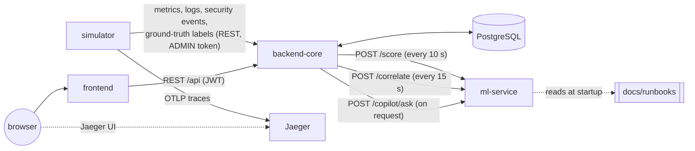

# Architecture

IntelliGuard is five services plus Jaeger, run with Docker Compose (`infra/docker-compose.yml` for
development, `infra/docker-compose.prod.yml` for a production-style deployment, see
[deployment.md](deployment.md)).

## Components

| Component | Tech | Responsibilities |
|---|---|---|
| **frontend** | React 19 + Vite | Dashboard: Overview (service health, risk, open incidents), Logs, Anomalies, and the Incidents workspace with the copilot panel. Talks only to backend-core. In production it is a static build served by nginx, which also proxies `/api` to backend-core (one origin). |
| **backend-core** | Spring Boot 4, Java 21 | Authentication (JWT) and role-based access, service registry and dependency graph, telemetry ingestion, ground-truth labels, the anomaly/risk scoring job, the incident correlation job, the incident workspace (notes, acknowledgement) and the copilot endpoint. The only component with database access. |
| **ml-service** | FastAPI, Python 3.11 | Stateless: `POST /score` (L1 anomaly detector: rolling robust z-score), `POST /correlate` (heuristic, graph-based grouping and root-cause ranking), `POST /copilot/ask` (retrieval-and-template answers over one incident's data and `docs/runbooks`). Not reachable from the browser. |
| **simulator** | Python | Generates synthetic metrics, logs and security events every 5 s for 8 services (modes: demo, continuous, normal, cascade), records the injected anomalies as ground-truth labels, registers the services and the 7-edge call graph, and emits traces to Jaeger. |
| **postgres** | PostgreSQL 16 | All persistent state (tables below). |
| **jaeger** | Jaeger all-in-one | Receives the simulator's OTLP traces; its UI shows the service call graph. |

## Data flow

The frontend never calls ml-service directly. If ml-service is unavailable, scoring falls back to
the fixed thresholds (L0), correlation skips the cycle and the copilot returns 503. The rest of
the dashboard keeps working.

## Database tables

| Table | Written by | Contents |
|---|---|---|
| `users`, `roles` | registration, admin endpoint, startup seeder | Accounts (BCrypt password hash) and roles `ROLE_VIEWER`, `ROLE_USER`, `ROLE_ADMIN` |
| `services` | services API, simulator | Service registry: name, type, criticality, legacy single `depends_on_service_id` |
| `service_dependencies` | dependency API, simulator, startup backfill | Dependency graph edges (unique pair, kept acyclic) |
| `metric_records`, `log_records` | ingestion API (simulator) | Telemetry samples and log lines per service |
| `security_events` | ingestion API (simulator) | e.g. FAILED_LOGIN, PORT_SCAN, with severity and details (jsonb) |
| `ground_truth_events` | ground-truth API (simulator) | Labels of injected anomalies, used only for evaluation, never by detection |
| `anomalies` | scoring job | Detected anomaly episodes per (service, metric, detector), OPEN/CLOSED, and their incident link |
| `risk_scores` | scoring job | Throttled history of service risk scores with their component breakdown (jsonb) |
| `incidents` | correlation job, workspace API | Correlated incidents: status, services, ranked root-cause candidates (jsonb), severity, events, acknowledgement |
| `incident_notes` | workspace API | Notes on incidents, with their author |

The schema is maintained by Hibernate (`ddl-auto=update`). Two small startup patches handle
changes it can't make: relaxing `risk_scores.incident_id` and widening the
`incidents.status` check.

## Endpoints and roles

From `SecurityConfig` and the controllers. "Any role" means any authenticated user (VIEWER, USER
or ADMIN). With no token or an invalid one the answer is 401; with the wrong role it is 403.

| Method | Path | Allowed |
|---|---|---|
| POST | `/api/auth/register` | public (creates VIEWER accounts only; USER/ADMIN → 403) |
| POST | `/api/auth/login` | public |
| GET | `/api/health` | public |
| POST | `/api/admin/users` | ADMIN |
| GET | `/api/services`, `/api/services/{id}` | any role |
| POST, PUT | `/api/services`, `/api/services/{id}` | USER, ADMIN |
| GET | `/api/services/{id}/metrics`, `/api/services/{id}/logs` | any role |
| POST | `/api/services/{id}/metrics`, `/api/services/{id}/logs` | ADMIN (telemetry ingestion) |
| GET | `/api/security-events` | any role |
| POST | `/api/security-events` | ADMIN |
| GET, POST | `/api/ground-truth` | ADMIN |
| GET | `/api/dashboard/summary` | any role |
| GET | `/api/logs` | any role |
| GET | `/api/anomalies` | any role |
| GET | `/api/risk/current`, `/api/risk/history` | any role |
| GET | `/api/service-dependencies` | any role |
| POST | `/api/service-dependencies` | USER, ADMIN |
| DELETE | `/api/service-dependencies/{id}` | USER, ADMIN |
| GET | `/api/incidents`, `/api/incidents/{id}` | any role |
| POST | `/api/incidents/{id}/notes`, `/api/incidents/{id}/acknowledge` | USER, ADMIN |
| POST | `/api/incidents/{id}/copilot/ask` | any role (reads only) |

ml-service (internal network only): `GET /health`, `POST /score`, `POST /correlate`,
`POST /copilot/ask`.

## Background jobs

| Job | When | What |
|---|---|---|
| `RiskScoringJob` | every 10 s (fixed delay, first run after 15 s) | For each service: fetch the newest metric window, evaluate L0 thresholds, call ml-service `/score` (L1), open, extend or close anomaly episodes (stale ones are closed, not extended), compute and publish risk. Every 60 cycles it applies retention: risk rows 24 h, closed anomalies 7 days. |
| `IncidentCorrelationJob` | every 15 s (fixed delay, first run after 20 s) | Send recent episodes and the dependency graph to `/correlate`, re-rank each changed incident with its own security events, and persist incidents (stable identity, merge/split, lifecycle with a 5-minute quiet period). Every 40 cycles it applies retention: resolved/merged incidents 7 days, with their notes. |
| `AdminAccountSeeder` | startup | Creates the ADMIN account from `SIMULATOR_ADMIN_PASSWORD` if missing; never modifies an existing account. |
| `LegacyDependencyBackfill` | startup | Copies legacy `depends_on_service_id` values into `service_dependencies` (idempotent). |
| `StaleEpisodeCleanup` | startup | Closes anomaly episodes left OPEN longer than `episode-stale-after` (5 min), e.g. by a stopped stack. |
| `RiskSchemaPatch`, `IncidentSchemaPatch` | startup | The two schema patches above. |

The two scheduled jobs run on separate scheduler threads, so a slow ml-service call in one never
delays the other.

More detail: [risk-engine.md](risk-engine.md), [incidents.md](incidents.md),
[copilot.md](copilot.md).
